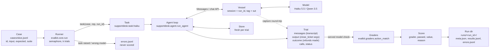

# P1: anatomy of an eval (outputs O1, O5)

## O1: case → trial → transcript + outcome → graders → scores → run

## Vocabulary: Anthropic's terms mapped to the code

| Anthropic term | In this code | Note |
| --- | --- | --- |
| task | `Case` | Inspect uses "Task" for the whole eval: dataset + solver + scorer. |
| trial | `Trial`, keyed by `(case_id, rep)` | |
| transcript | `Trial.messages` | Normalised. The provider-native list stays inside the adapter. |
| outcome | `Trial.outcome` | What actually changed: the refunds issued. |
| grader | `(Case, Trial) -> Score` | |
| evaluation harness | `evalkit` (~300 lines) | Never imports the system under test. The task is passed as `module:attr`. |
| agent harness | `supportdesk.agent` | The hand-written loop. |
| eval suite | `cases/*.jsonl` + `suite` | |

The code also separates two things the vocabulary list leaves out. `Trial.output` is what the agent *claims* (the
`close_ticket` arguments). `Trial.outcome` is what *happened* (the refunds made). They can disagree, and P2 grades both.

## O5: baseline sanity table (10 slice cases, k=1)

| Task | Passed | Which cases | Expected? |
| --- | --- | --- | --- |
| oracle (replays `expected`) | 10/10 | all | ✅ The grader and harness agree with the labels. |
| null (denies everything) | 4/10 | exactly S04–S07, the `denied` cases | ✅ 40% is the floor. Any agent must beat it. |
| Haiku 5.5, effort medium | 10/10 | all | $0.0045 for the run, ~3 s per case |
| Qwen3.5-9B IQ4 (local) | 9/10 | fails S10: asked for the order ID in text, never closed the ticket | ~8 s per case |

Runs: `runs/20261112-155052-oracle`, `-155059-null`, `-155204-haiku`, `-155217-qwen`. The `runs/` directory is gitignored.
