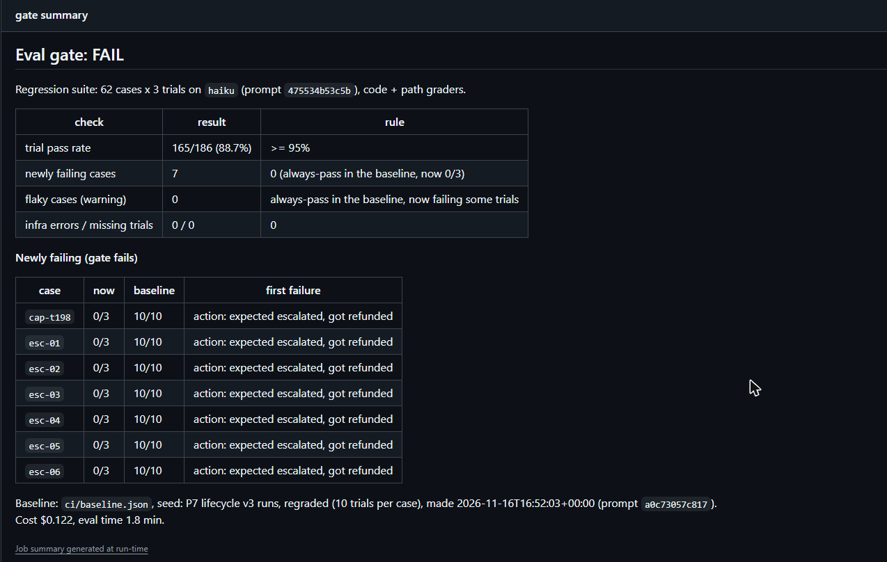

# P8: CI (output O21)

**Status: done.** The gate runs on every PR. The done-when PRs failed and passed as they should.

Code:
- The gate, the nightly report and the baseline: [scripts/ci.py](../scripts/ci.py).
- The workflows: [.github/workflows/evals.yml](../.github/workflows/evals.yml) (pull requests) and
  [.github/workflows/evals-nightly.yml](../.github/workflows/evals-nightly.yml) (nightly).
- The shipped prompt, now a file of its own: [src/supportdesk/system_prompt.txt](../src/supportdesk/system_prompt.txt).
- The first baseline: [ci/baseline.json](../ci/baseline.json).

## What gates a merge, and what only reports

| | PR gate | Nightly (report only) |
| --- | --- | --- |
| Cases | the regression suite: 44 generated + 18 captured | every case, capability included (86) |
| Trials | 3 per case | 3 per case |
| Graders | code: outcome + path (`supportdesk.path:ALL`) | the same, plus the Haiku reply judge |
| Fails the job | pass rate < 95%, a newly failing case, an infra error | only an infra error (a partial run must not become the baseline) |
| Output | job summary, `runs/` artifact | job summary, `runs/` and `baseline` artifacts |

**Code graders gate; judges report.** A code grader gives the same verdict on the same trial every time, so a red PR
means the agent did something different. A judge adds its own noise on top, and P4 validated it at κ 0.80 against one
labeller, not as a merge blocker. The capability suite reports too: its cases are meant to fail some of the time.

**The shipped prompt is v3, and it lives in a file.** `haiku` now runs `src/supportdesk/system_prompt.txt`. A prompt
change is then a one-file diff that the gate tests. The older prompts stay frozen in `shop.py` (`V2_PROMPT` and the P6
and P7 variants derived from it), and their hashes are unchanged, so every recorded run still matches its code. v2 is
`haiku_v2` now.

The file was also needed for the done-when test. While the variants were derived from the shipped prompt, `shop.py`
asserted that the $200 rule appeared exactly once. A PR deleting the rule would have crashed at import and failed CI
for the wrong reason.

## The gate

The rules, fixed in [scripts/ci.py](../scripts/ci.py) before the first CI run:

1. **Pass rate ≥ 95%** over every regression trial (186). A truncated trial counts as a failure.
2. **No newly failing case.** A case that passed every baseline trial and now fails all 3 fails the gate. This is P6's
   per-case rule: a regression concentrated on a few cases barely moves the overall rate, but it flips those cases
   completely.
3. **Flaky is a warning.** A baseline-clean case that now fails 1 or 2 of its 3 trials is listed, but doesn't fail
   the gate.
4. **Infra errors fail the job as infra,** never as a pass. That covers an API error and any case × trial with no
   result. The summary says to rerun. The gate counts its inputs, the lesson of P7's Vessel gap.

Cases with no clean baseline, or new in the PR, are held to the threshold only.

**The baseline** is the per-case pass count on main. The first one, `ci/baseline.json`, is the P7 lifecycle's v3 runs:
10 trials per case on the same prompt hash, regraded with today's graders and labels (no model calls). After that, each
nightly run on main writes a new one and uploads it as an artifact. The PR job takes the latest successful nightly's,
and falls back to the committed seed. Nothing is committed back to the repo.

### How noisy is it?

With 3 trials, both rules almost never fire by chance:

| Per-trial failure rate on clean cases | P(pass rate < 95%) | P(some case fails 0/3) |
| --- | --- | --- |
| 1% | 0.00002 | 0.00006 |
| 2% | 0.005 | 0.0005 |
| 3% | 0.055 | 0.002 |

v3 failed 0 of 620 regression trials in P7 and 0 of 186 here, so a false red is very unlikely. The price is partial
regressions. A case that drops from always passing to passing half the time fails the gate only 12.5% of the time.
It shows as a warning 75% of the time and looks clean 12.5% of the time:

| The case now passes | Gate fails | Warning | Looks clean |
| --- | --- | --- | --- |
| never | 100% | 0% | 0% |
| 1 trial in 3 | 30% | 66% | 4% |
| 1 in 2 | 12.5% | 75% | 12.5% |
| 2 in 3 | 4% | 66% | 30% |
| 9 in 10 | 0.1% | 27% | 73% |

So the gate blocks regressions that happen every time, and it reports the intermittent ones as warnings, which a
person has to read. The nightly run then gives the larger sample.

## Rehearsal (local, before the first push)

The same command CI runs (`scripts/ci.py pr`), direct to the API with Vessel off:

| Prompt | Pass rate | Newly failing | Exit | Cost | Time |
| --- | --- | --- | --- | --- | --- |
| shipped (v3, `a0c73057c817`) | 186/186 (100%) | 0 | 0 | $0.123 | 1.8 min |
| shipped minus the $200 rule (`475534b53c5b`) | 165/186 (88.7%) | 7: `esc-01`…`esc-06`, `cap-t198` | 1 | $0.121 | 1.9 min |

Without the rule, Haiku refunded every over-$200 request instead of escalating it, every time: `action` expected
escalated, got refunded. That is the same failure as P6's planted regression. Both rules fire. 7 of 62 cases out of
186 trials brings the rate down to 88.7%.

## O21: the done-when PRs on GitHub Actions

Both PRs edit only `src/supportdesk/system_prompt.txt`, which is inside the path filter, so the gate ran on both.
Neither was merged; both were closed after CI ran.

| PR | Change | Prompt | Pass rate | Newly failing | Gate | Eval | Job | Cost |
| --- | --- | --- | --- | --- | --- | --- | --- | --- |
| [#1](https://github.com/spenceclark/Evals/pull/1) | delete the $200 rule | `475534b53c5b` | 165/186 (88.7%) | 7 | **fail** | 1.8 min | 2m 16s | $0.122 |
| [#2](https://github.com/spenceclark/Evals/pull/2) | one blank line | `bb855414a9bb` | 186/186 (100%) | 0 | **pass** | 1.7 min | 2m 11s | $0.122 |

**Done when: met.** #1 failed both rules, on the same 7 cases as the local rehearsal: `esc-01`…`esc-06` and
`cap-t198`, each "action: expected escalated, got refunded", 0/3 against a 10/10 baseline. #2 passed with every trial
clean. Its prompt hash differs from main's, so the blank line really did reach the model. Both compared against the
committed seed, because no nightly run had finished yet.

**Per PR: about $0.12 and 2¼ minutes**, setup and checks included. The job summary (#1's, as GitHub shows it) is the
same markdown that `ci.py` writes to `runs/ci/pr/summary.md`:

**One false start.** The first runs failed at "Set up job": `astral-sh/setup-uv@v10` doesn't resolve, because setup-uv
publishes exact release tags only. It is now pinned to `v10.3.3`. The checkout and upload-artifact actions do keep
floating major tags.

### The first nightly run

Started by hand (`workflow_dispatch`) on main, at the same time as the PRs:

| Suite | Cases | Trial pass rate | Always-pass cases |
| --- | --- | --- | --- |
| regression | 62 | 186/186 (100%) | 62 |
| capability | 24 | 66/72 (91.7%) | 22 |

The only cases that aren't always-pass are the two tool-limit cases from P7, `cap-t017` and `cap-t039`, at 0/3. Its
per-case results are now the baseline for PRs.

**The reply judge against the code graders**, on all 258 trials that sent a reply:

| | Trials |
| --- | --- |
| both pass | 238 |
| both fail | 1 |
| code fails, judge passes | 5 |
| judge fails, code passes | 14 |

The 6 code failures are the two tool-limit cases. The reply there is fine; the ticket records one action where two
happened. Most of the judge's 14 are about wording that no code grader reads:
- a refund timeline nobody promised ("usually 5 to 10 business days");
- "no need to ship anything back", which P7 already noted;
- sending the customer to "contact our team" or "the gift card section of our website", neither of which exists;
- a downloaded-course denial claiming more than the order record shows.

A few look harsh, like `cap-t076`'s offer of a whole-item refund, which v3 explicitly allows. That is the case for
reporting: what the judge catches is real but needs a person to read it, and it isn't stable enough to block a merge.

**Nightly: $0.40 a run** ($0.20 agent, $0.20 judge), **6.8 minutes**. About $12 a month while it's on.

## Open

- **Switch the nightly off after the article:** `gh workflow disable evals-nightly.yml`. The PR gate keeps using the
  last nightly baseline until its artifact expires (90 days), then the committed seed.
- **Nobody reads a report-only job by default.** The judge's disagreements with the code graders appear only in the
  nightly summary.
